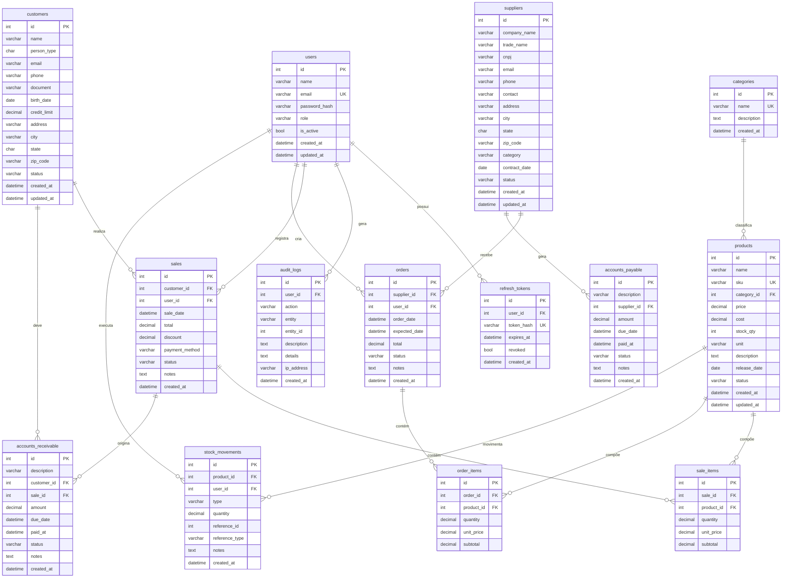

# GestãoPro — Diagrama Entidade-Relacionamento (ERD)

## Diagrama ERD (Mermaid)

---

## Descrição dos Relacionamentos

### Usuários e Segurança
- `users` ← 1:N → `refresh_tokens`: Um usuário pode ter múltiplos tokens de renovação ativos
- `users` ← 1:N → `audit_logs`: Toda ação autenticada gera um registro de auditoria

### Produtos e Categorias
- `categories` ← 1:N → `products`: Um produto pertence a uma categoria

### Ciclo de Vendas
- `customers` ← 1:N → `sales`: Um cliente pode ter múltiplas vendas
- `sales` ← 1:N → `sale_items`: Uma venda contém múltiplos itens
- `products` ← 1:N → `sale_items`: Um produto pode aparecer em múltiplos itens de venda
- `sales` ← 1:N → `accounts_receivable`: Vendas geram contas a receber

### Ciclo de Compras
- `suppliers` ← 1:N → `orders`: Um fornecedor pode receber múltiplos pedidos
- `orders` ← 1:N → `order_items`: Um pedido contém múltiplos itens
- `products` ← 1:N → `order_items`: Um produto pode aparecer em múltiplos itens de pedido
- `suppliers` ← 1:N → `accounts_payable`: Fornecedores geram contas a pagar

### Estoque
- `products` ← 1:N → `stock_movements`: Todo movimentação de estoque referencia um produto
- Tipos de movimentação: `in` (entrada), `out` (saída), `adjust` (ajuste)

---

## Cardinalidade das Entidades Principais

| Entidade           | Registros esperados (produção) |
|--------------------|-------------------------------|
| users              | Dezenas (equipe interna)      |
| categories         | Dezenas                       |
| products           | Centenas a milhares           |
| customers          | Milhares                      |
| suppliers          | Dezenas a centenas            |
| sales              | Milhares / mês                |
| sale_items         | Dezenas de milhares / mês     |
| orders             | Centenas / mês                |
| stock_movements    | Dezenas de milhares           |
| audit_logs         | Alta frequência (> 1M/ano)    |

---

## Índices Relevantes

| Tabela              | Índice                   | Tipo    | Justificativa                |
|---------------------|--------------------------|---------|------------------------------|
| users               | email                    | UNIQUE  | Login, unicidade             |
| products            | sku                      | UNIQUE  | Identificador de produto     |
| products            | name                     | INDEX   | Busca textual frequente      |
| products            | status                   | INDEX   | Filtro de ativos/inativos    |
| customers           | name                     | INDEX   | Busca textual                |
| customers           | status                   | INDEX   | Filtro                       |
| suppliers           | company_name             | INDEX   | Busca textual                |
| audit_logs          | entity                   | INDEX   | Filtra logs por entidade     |
| audit_logs          | created_at               | INDEX   | Consultas por período        |
| stock_movements     | product_id               | INDEX   | Histórico de produto         |
| accounts_payable    | due_date, status         | INDEX   | Dashboard financeiro         |
| accounts_receivable | due_date, status         | INDEX   | Dashboard financeiro         |

---

*GestãoPro — Fatec Americana — 2025*
